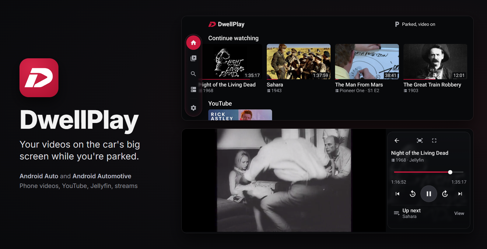
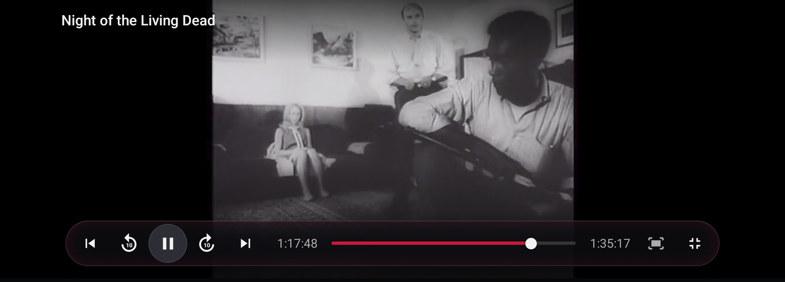
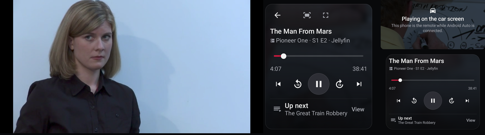
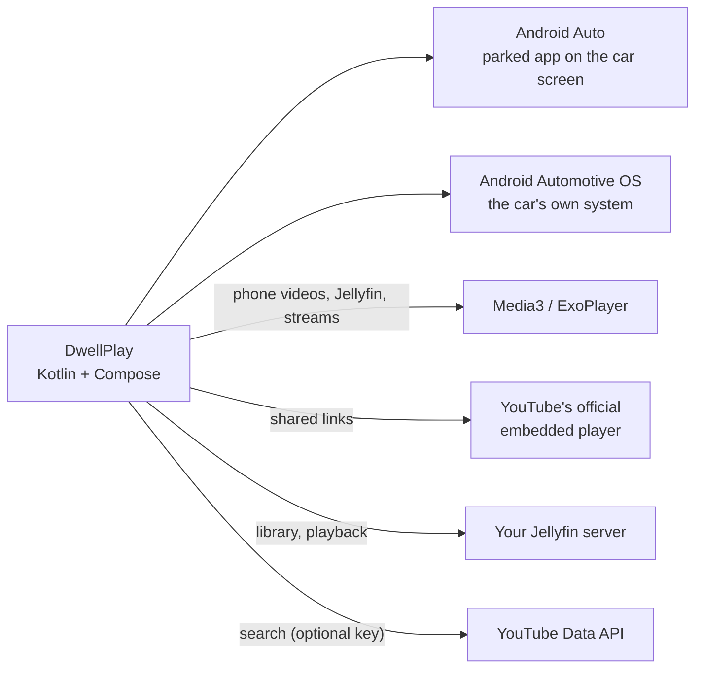

<p align="center">
  
</p>

<p align="center">
  <strong>Your videos on the car's big screen while you're parked.</strong><br>
  Phone videos, YouTube, your Jellyfin server and stream links, on Android Auto, Android Automotive and the phone.
</p>

<p align="center">
  <a href="#screenshots">Screenshots</a>
  &nbsp;·&nbsp;
  <a href="#features">Features</a>
  &nbsp;·&nbsp;
  <a href="#the-safety-rules">Safety</a>
  &nbsp;·&nbsp;
  <a href="#privacy-and-security">Privacy</a>
  &nbsp;·&nbsp;
  <a href="#build-it">Build it</a>
  &nbsp;·&nbsp;
  <a href="#put-it-in-the-car">Put it in the car</a>
</p>

<p align="center">
  
  
  
  
</p>

## Why DwellPlay

A parked car has the biggest, best-placed screen most people own, and it sits idle through every wait: charging, a pickup, a lunch break. DwellPlay puts your own media on it. The picture shows only while the car is parked; once it moves, your own videos carry on as sound and YouTube stops, and the picture waits for a tap when you park again.

It is a personal project, built first for one car: a Tata Curvv with a 10.25-inch 1920x720 screen and wireless Android Auto. One adaptive app covers the phone, Android Auto's car screen and cars running Android Automotive OS.

## Screenshots

**In the car** (the Curvv's 1920x720 panel):

<table>
  <tr>
    <td align="center"><br><sub>Home: posters slide under the glass rail</sub></td>
    <td align="center"><br><sub>The player: picture and controls side by side</sub></td>
  </tr>
  <tr>
    <td align="center" colspan="2"><br><sub>Full screen: the picture stays clear, everything else in one bar</sub></td>
  </tr>
</table>

**On the phone:** Home with the dock, the player, what it shows while the car moves, and the prompt after you park.

<p align="center"></p>

**The phone as the remote.** With Android Auto connected, a film picked on the phone opens on the car screen, and the phone keeps the controls without the picture.

<p align="center"></p>

## Features

- **Made for a parked car.** Wide panoramic screens get the picture and a control panel side by side; narrower and portrait screens stack them. Targets are 76dp and text 24sp or larger in the car, the scale Google asks for.
- **Navigation shared with WearWise and Dueline.** A floating pill of icon tabs on the phone, where the current tab opens into a crimson pill with its name, and the same pill standing upright beside the content on a wide car screen. Both are liquid glass: on Android 13 and later a GPU shader bends what scrolls underneath along the rim.
- **Full screen without clutter.** Title at the top, one glass bar along the bottom with transport, the seek line with its times, and the picture options. Nothing sits in the top corners, where Android Auto takes the touches.
- **The phone as the remote.** While Android Auto is connected, anything picked on the phone plays on the car screen, which opens its player by itself.
- **Your own folder.** Phone videos come only from **Movies › DwellPlay**, the way some apps keep their own folder. The rest of the phone never appears unless you add a folder in Sources.
- **Resume where you stopped.** Watch progress is kept for everything, and Continue watching brings it back on the phone and in the car.
- **YouTube done properly.** Shared links play in YouTube's official embedded player with nothing drawn over it. Search works with a free YouTube Data API key.
- **Jellyfin.** Sign in to your own server. It sends the original file when the car can play it and converts it on the fly when it can't.
- **Costs nothing to run.** No accounts, no servers of our own, no analytics.

## What it plays

| Source | How |
|---|---|
| Videos on the phone | The DwellPlay folder (Movies › DwellPlay), read from the phone's own library. Through Android Auto the app runs on the phone, so these play on the car screen with no copying. |
| A folder or USB drive | Picked with the system file picker. Only that folder is read. |
| YouTube | Only in YouTube's official embedded player. Share a video or playlist from the YouTube app to DwellPlay, or paste a link. |
| Jellyfin | Your own server, over https, or plain http on your home network. |
| Stream links | HLS (.m3u8), DASH (.mpd) or a video file link you own. |

Netflix, Prime Video and other subscription services play only in their own apps. DwellPlay does not try to play them.

## The safety rules

These are the product, not an add-on. They live in one small state machine ([core/.../policy](core/src/main/kotlin/com/thealgothrim/dwellplay/core/policy)) with a unit test for every rule.

- Video shows only while the car's own system says it is parked. There is no gear or speed shortcut in the app.
- When the car moves, YouTube stops completely. Its rules forbid audio-only or background play, and the code makes that impossible by type, not by convention.
- Your own videos (phone, folder, Jellyfin, links) can carry on as sound while you drive, if you leave that setting on and the car allows it.
- After a drive the picture never restarts by itself. You tap "Resume video". Automatic next-in-queue and play from the car's media controls keep that rule.
- While Android Auto is connected the phone never shows video, so nothing plays on a phone a driver can see.

## Privacy and security

- **Nothing leaves the phone.** No accounts, no analytics, no crash reporting. The library, watch progress and settings stay in the app's private storage, and backups are off.
- **Only your DwellPlay folder.** Personal videos elsewhere on the phone never reach a screen a passenger can see, and watch history and search follow the same rule.
- **Encryption on the internet.** Plain http is allowed only to addresses on your own network (a home Jellyfin box, a NAS, a Tailscale address). Anything on the internet must use https; an http address for a server on the internet is upgraded to https, and an http stream link from the internet is refused.
- **Sign-ins are encrypted.** The Jellyfin token is sealed with a key in the Android Keystore.
- **Other apps can't read what you watch.** The media service answers only the system (notification, Bluetooth, lock screen), Android Auto, the car's media centre and Google's assistants.
- **The YouTube player is boxed in.** It runs on a page bundled with the app, can't open files or other apps' content, and links out of it go to the YouTube app or the browser, never into the player.
- **No keys in the repository.** Your own YouTube key and signing details go in `local.properties`, which git ignores. Release APKs here are built without a YouTube key.

## How it works



- **One app, two builds.** `personal` reaches Android Auto today through its parked-app route, which accepts only games for now, so it declares itself one; keep it to sideloading or Play's internal testing. `store` carries the honest video declaration for Android Automotive OS and for Android Auto when Google opens video apps (announced May 2026).
- **One coordinator.** `PlayerHub` owns playback for every window, the phone's and the car's, and runs each change through the safety state machine in `core`, plain Kotlin with no Android in it.
- **Two windows.** Android Auto starts its own entry (`CarActivity`, a separate task), so the phone and the car screen each keep a DwellPlay window and the phone can act as the remote.
- **The mark is geometry.** [tools/icon/mark.py](tools/icon/mark.py) builds the italic D from two angles and circular fillets, and writes the launcher icon, the themed icon, the status bar icon, the splash and the in-app wordmark from it.

More in [docs/architecture.md](docs/architecture.md), [docs/android-auto.md](docs/android-auto.md) and [DESIGN.md](DESIGN.md).

## Build it

You need JDK 21 and the Android SDK (platform 36).

```powershell
.\gradlew.bat :core:test                                        # 49 unit tests: safety rules, links, network rule, clients
powershell -File tools/build-install.ps1 -Launch                 # build the personal debug app and install it
powershell -File tools/build-install.ps1 -Flavor store -Launch   # the store build
bash tools/demo-data.sh emulator-5554                            # demo content on an emulator
```

Debug builds are their own app ("DwellPlay debug", crimson on black), installed next to the real one, and take test commands over adb: pretend the car moves, add a link, play something. See [docs/testing.md](docs/testing.md).

**YouTube search (free, no card):** enable the YouTube Data API v3 in a Google Cloud project, create an API key restricted to that API, and add `youtubeApiKey=<key>` to `local.properties`, or paste it into DwellPlay's Settings. Google allows 100 searches a day; playing shared links doesn't count.

## Put it in the car

**Android Auto** (the phone runs Android 15 or later):

1. Install the APK from [Releases](https://github.com/TheAlgo7/DwellPlay/releases) or build the `personal` flavor.
2. Phone: Settings > Connected devices > Android Auto > tap **Version** 10 times, then ⋮ > **Developer settings** > turn on **Unknown sources**. Android Auto accepts sideloaded parked apps once it's on.
3. Connect to the car and open DwellPlay from the car's app grid while parked.
4. Put the videos you want in the car in **Movies › DwellPlay** on the phone.

**Android Automotive OS:** install the `store` build with adb; see [docs/testing.md](docs/testing.md).

## Project structure

```text
core/          plain Kotlin: media model, safety state machine, link parsing, the local-network
               rule, the Jellyfin and YouTube clients. No Android, so its tests run in seconds.
app/           the Android app: Compose screens, liquid glass, the Media3 player service, the
               YouTube embed, phone and folder sources, car detection.
docs/          architecture, the Android Auto route, testing, the images on this page.
tools/         icon geometry, README images, build and install, demo data, the head unit preset.
```

| Tool | What it does |
|---|---|
| `tools/icon/mark.py` | Writes every icon and the in-app mark from the mark's geometry |
| `tools/readme_images.py` | Builds the images on this page, banner included, from emulator screenshots |
| `tools/build-install.ps1` | Builds a flavor and installs it on a phone or emulator |
| `tools/demo-data.sh` | Test videos, a YouTube link, a stream and Jellyfin's demo server on an emulator |
| `tools/dhu/` | The Desktop Head Unit preset for the Curvv's screen, and a console to drive it |

## Known limits

- Tested on a Galaxy S24 Ultra, the Desktop Head Unit at the Curvv's screen size and emulators. An earlier build played in the real Curvv; 0.2.0 has not been in the car yet.
- Android Auto's parked-app route is meant for games. Google is opening it to video apps, starting with Android 17 phones.
- The liquid glass bend needs Android 13; older phones get a tinted surface.
- YouTube search needs your own free key, and Google caps it at 100 searches a day.
- Not built yet: Plex and DLNA sources, DRM streams, voice search. The reasoning is in [docs/architecture.md](docs/architecture.md).

## Credits

Playback: AndroidX Media3 (Apache 2.0). Images: Coil (Apache 2.0). Networking: OkHttp (Apache 2.0). Icons: Material Icons path data (Apache 2.0). Jellyfin is a trademark of the Jellyfin project and YouTube of Google; DwellPlay is not affiliated with either. The screenshots show Jellyfin's public demo server and test patterns.

## Licence

Copyright © 2026 Gaurav Kumar, [The Algothrim](https://thealgothrim.com). All rights reserved.

The code is public to read and learn from. It is not licensed for reuse. Third-party code keeps its own licence.
