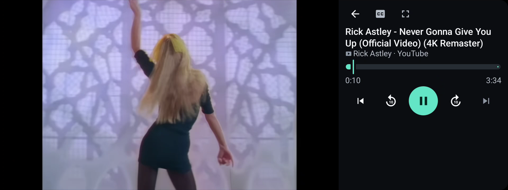
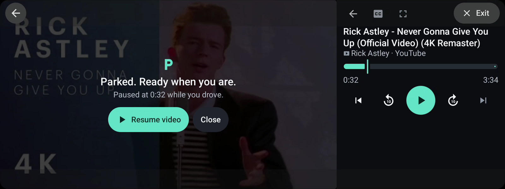
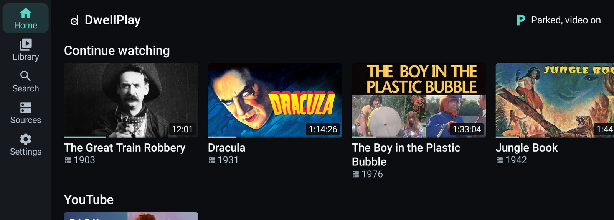
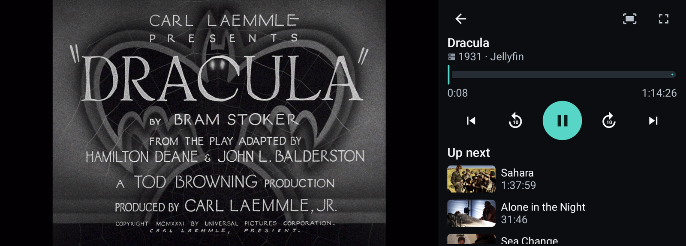
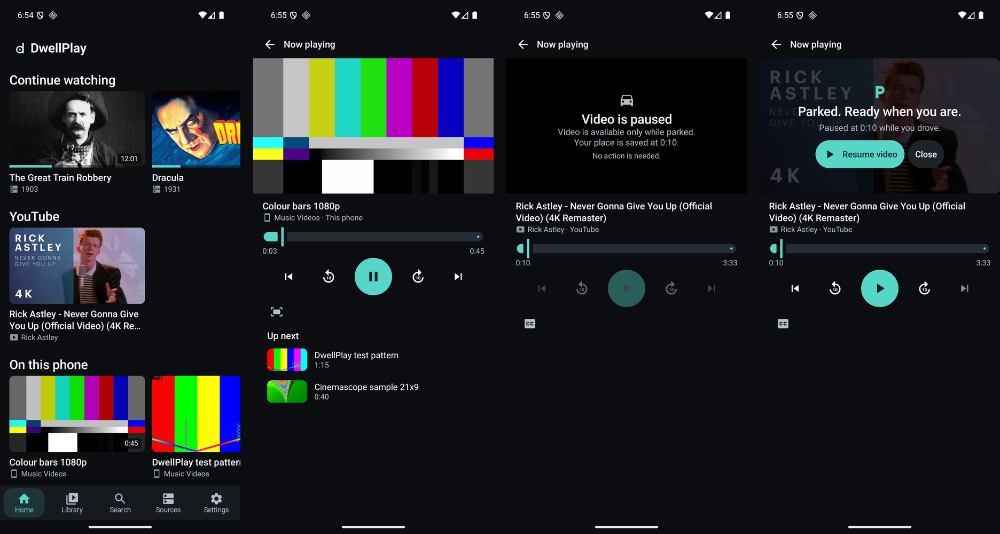
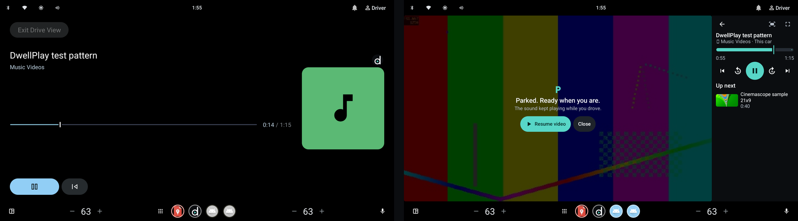

# DwellPlay

Your parked-screen media hub: videos on your phone, YouTube, your own Jellyfin server and stream links, on the car's big screen whenever you're parked. When you drive, the picture goes away and your own videos carry on as sound.

One Android app for three screens: the phone, the car screen through Android Auto, and cars that run Android Automotive OS (Google built-in).



Above: Android Auto itself (the Desktop Head Unit set to a Tata Curvv's 1920x720 screen, driven by a real phone). Below: after a drive, the picture waits for a tap. The back arrow and Exit button in the corners are Android Auto's own.



Home on the car screen, and a film from a Jellyfin server in the player:





On the phone: home, the player, what it shows while the car moves, and the prompt after you park.



On Android Automotive OS the car itself takes over while driving (its Drive View keeps the sound going), and DwellPlay waits for a tap once you've parked.



## What it plays

| Source | How |
|---|---|
| Videos on the phone | Read from the phone's own library. Through Android Auto the app runs on the phone, so these play on the car screen with no copying. |
| A folder or USB drive | Picked with the system file picker. Only that folder is read. |
| YouTube | Only in YouTube's official embedded player. Share a video or playlist from the YouTube app to DwellPlay, or paste a link. Search works once a free YouTube Data API key is added in Settings. |
| Jellyfin | Sign in to your own server. It sends the original file when the car can play it and converts it on the fly when it can't. |
| Stream links | HLS (.m3u8), DASH (.mpd) or a video file link you own. |

Netflix, Prime Video and other subscription services play only in their own apps. DwellPlay does not try to play them.

## The safety rules

These are the product, not an add-on. They live in one small state machine ([core/.../policy](core/src/main/kotlin/com/thealgothrim/dwellplay/core/policy)) with a unit test for every rule.

- Video shows only while the car's own system says it is parked. There is no gear or speed shortcut in the app.
- When the car moves, YouTube stops completely. Its rules forbid audio-only or background play, and the code makes that impossible by type, not by convention.
- Your own videos (phone, folder, Jellyfin, links) can carry on as sound while you drive, if you leave that setting on and the car allows it.
- After a drive the picture never restarts by itself. You tap "Resume video".

## How it reaches a car

| Screen | Build | Status |
|---|---|---|
| Android Auto (for example a Tata Curvv) | `personal` | Android Auto already runs parked apps on the car screen from Android 15. Today it opens that door only to games, so this build declares itself as one. Works on the Desktop Head Unit with a real phone (Android 16, Android Auto 17.7): parked, it plays; driving, Android Auto takes the screen and only your own videos carry on as sound. For personal use through Play's internal testing track only. |
| Android Auto, officially | `store` | Google announced video apps for Android Auto in May 2026 (Tata is on the launch list, phones need Android 17). When it opens, the `store` build's honest `video` declaration is what ships. |
| Android Automotive OS | `store` | Supported by Google for video apps today. Works on the Android 15 car emulator with real driving restrictions. |

Details and the step-by-step for a real car are in [docs/android-auto.md](docs/android-auto.md).

## Build and try it

Needs JDK 21 and the Android SDK (platform 36).

```powershell
# unit tests for the safety rules, link parsing and the Jellyfin and YouTube clients
.\gradlew.bat :core:test

# build and install on a connected phone or emulator
powershell -File tools/build-install.ps1 -Launch                  # personal build
powershell -File tools/build-install.ps1 -Flavor store -Launch    # store build

# put demo content on an emulator (test videos, a YouTube link, Jellyfin's public demo server)
bash tools/demo-data.sh emulator-5554
```

Debug builds install next to the real app as "DwellPlay debug" and accept test commands over adb (pretend the car is driving, add a link, play something). See [docs/testing.md](docs/testing.md).

## Layout

```text
core/    plain Kotlin: the media model, the safety state machine, link parsing,
         the Jellyfin and YouTube clients. No Android, so its tests run in seconds.
app/     the Android app: Compose screens, the Media3 player service, the YouTube embed,
         phone and folder sources, car detection.
docs/    architecture, the Android Auto route, testing.
tools/   build and install, demo data, screenshots, the Desktop Head Unit preset.
```

## Not built yet

Plex and DLNA sources, a phone-to-car bridge for Android Automotive OS (not needed through Android Auto), DRM streams a rights holder would have to authorise, and search by voice. The reasoning for each is in [docs/architecture.md](docs/architecture.md).
