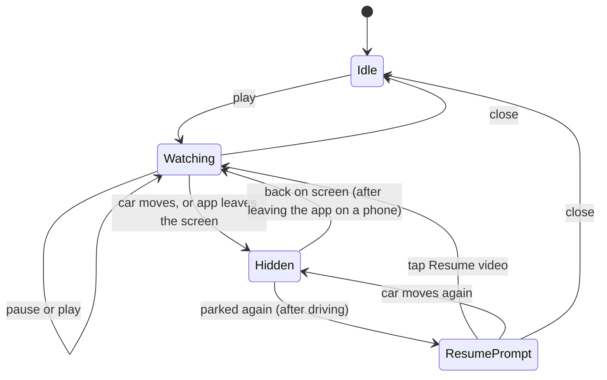

# Architecture

DwellPlay started from a research report (30 September 2026) that proposed three separate apps: an Android Automotive OS video app, a phone companion, and an Android Auto audio service. This is what was built instead, and why.

## What changed from the report

| The report said | What's true and what DwellPlay does |
|---|---|
| Android Auto has no video, so build for Android Automotive OS first and keep an Android Auto adapter "dormant". | Android Auto already runs parked apps as normal activities on the car screen (phones on Android 15 and newer; games only for now), and in May 2026 Google announced video apps for Android Auto with Tata on the launch list. So the app is built as the adaptive video app Google describes, and reaches Android Auto today through the parked-app door. See [android-auto.md](android-auto.md). |
| Three apps: car app, phone companion, Android Auto audio. | One adaptive app. Google's own model in 2026 is "build once": the same app runs on the phone, is projected by Android Auto when parked, and installs on cars with Google built-in. |
| Phone videos need a pairing and streaming bridge (phase two). | Only on Android Automotive OS, where the app runs in the car. Through Android Auto the app runs on the phone, so phone videos are simply local. They are a first-class source from day one. The bridge is still "later", and only matters for cars with Google built-in. |
| About 25 Gradle modules. | Two: `core` (plain Kotlin, fast tests) and `app`. The boundary that matters, safety rules separate from Android, is kept. The rest was ceremony for a project this size. |
| YouTube needs the Data API. | Only search does. Shared links and playlists work with no key (titles come from YouTube's oEmbed endpoint). Search is switched on by adding a key, and asks only for videos whose owners allow embedding. |
| A safety gate class. | A pure state machine with every transition unit tested, including the ones the report listed as manual release checks. |

Kept from the report: large car typography and targets, YouTube only through the official player, no Netflix or Prime playback, Jellyfin's direct play or transcode negotiation, and the platform's restriction signal as the only authority on "parked". On 1 October 2026 the Dark Cinema refinement replaced teal with restrained crimson and updated navigation and player composition without splitting the app.

## One app, three screens

`MainActivity` is the only activity. `CarScreens.detect` works out where it is:

- **Phone**: the default display.
- **Android Auto**: a display other than the phone's while Android Auto is projecting. Android Auto decides when a parked app may be shown and takes the screen away when the car moves.
- **Android Automotive OS**: a car all the way through. `AutomotiveRestrictions` listens to `CarUxRestrictionsManager` and uses only `isRequiresDistractionOptimization`, as Google's guidance asks.

The layout follows the window, not the device. Four primary destinations (Home, Library, Search and Sources) use an inset rail in roomy landscape windows and a floating dock elsewhere. Settings is a secondary action in Home and the rail footer. Unusually narrow docks scroll horizontally rather than reducing target size. Car screens retain car sizes (76dp targets, an 88dp play button, 24sp readable labels).

The player uses approximately 70/30 video and controls on panoramic windows when minimum widths allow it. Portrait and narrower car windows stack a fixed video stage above independently scrolling controls and an expandable queue. Short windows use full screen, with adjacent controls for YouTube. Artwork atmosphere comes from a cached small still on a separate softened layer; no playing-frame analysis or blur of the controls is required. The graphite/crimson tokens and visual decisions are in [DESIGN.md](../DESIGN.md).

Two adjustments apply only on Android Auto, both found on the head unit (details in [android-auto.md](android-auto.md)): the layout is computed at the head unit's own density rather than the 1.31 times denser one Android Auto hands a parked app, and nothing tappable sits in the two top corners where Android Auto draws its own back and Exit buttons.

## Two players behind one hub

```text
                 PlayerHub  (rules, queue, positions)
                /                                    \
   Media3 ExoPlayer in PlaybackService        YouTube IFrame player in a WebView
   phone files, folders, Jellyfin, links      YouTube only
```

`PlaybackDescriptor` has two shapes and nothing converts between them:

- `Native(uri, ...)` is played by Media3. It carries `drivingAudioEligible`.
- `YouTube(videoId)` has no URI at all. It can only be handed to the embed.

That is deliberate. A YouTube video cannot be routed into the native player, which means it cannot be extracted, stripped of ads or played as background audio by a later "small feature". The media list other apps can browse (Android Auto's media screen in the `store` build, Bluetooth, the phone's own media controls) leaves YouTube out for the same reason.

The native player lives in a `MediaLibraryService` so sound can outlive the screen: a notification on the phone, Android Auto's dashboard media card while driving, and Android Automotive OS's Drive View on cars that allow audio while driving.

Android Auto lists one entry per app and prefers a driving-optimized one, so the two builds differ here: `store` declares the media list to Android Auto, `personal` does not, because declaring it hides the parked video screen.

## The safety state machine

`core/.../policy/SafetyMachine.kt`. The app feeds it events and carries out the effects it returns.



What `Hidden` does to playback is one function, `SafetyPolicy.whenHidden`:

| Playing | Car moves | App leaves the screen |
|---|---|---|
| YouTube | stopped and unloaded | stopped and unloaded |
| Own media, sound setting on, car allows it | sound carries on | sound carries on |
| Own media otherwise | paused | paused |

"Car allows it" means: through Android Auto, yes (the phone plays it like any music app); on Android Automotive OS, only if the car reports the background-audio-while-driving feature.

Rules the tests pin down (`core/src/test/.../SafetyTest.kt`):

- YouTube never becomes audio, whatever the car or the settings say.
- Nothing pressed while the picture is hidden can bring the picture back. Pressing play from the car's media controls re-runs the rules, so something that may not play is paused again.
- A drive always ends in the Resume prompt. Moving pictures never start by themselves.
- Automatic next-title loading while Resume is pending retains that prompt and rechecks audio permission. External media play can resume eligible native sound without showing the picture; it cannot start YouTube. Choosing a title in the app or tapping Resume is a deliberate video action.
- Leaving the app and then driving is treated as driving.

On top of that, Android Automotive OS covers non-driving-safe apps with its own blocking screen, Android Auto removes a parked app from the car screen, and DwellPlay's own opaque cover hides everything while restrictions are on. Dialogs use their own Android window, so they are not mounted during restrictions; their pending navigation state is retained for parking. Three layers, and only the first two are the platform's.

## YouTube, by the rules

Following YouTube's required minimum functionality:

- The official IFrame player, loaded with `https://<application id>` as the page origin so YouTube receives the Referer it requires. No extracted streams, ever.
- Nothing is drawn over the player. DwellPlay's controls sit beside it; in full screen they move to a slim column next to the picture.
- In stacked layouts, only metadata and controls scroll; the official player remains in a fixed visible stage.
- It plays only while visible. Closing the player screen, leaving the app or driving stops and unloads it.
- A layout remount requests the hub's current position, playlist index, captions and play/pause intent, rather than replaying the original load. The hub rejects stale or restricted mount requests, and callbacks from a disposed or detached WebView are ignored.
- Ads, controls and branding are untouched.
- Owners who disallow embedding produce "allowed only on YouTube", with a button to open the YouTube app.

## Things deliberately not built

- **Netflix, Prime Video and similar.** Their players are the only lawful way to watch them. Links to them are recognised and refused with a plain message.
- **DRM streams.** Media3 can play Widevine content when a rights holder supplies the licence details. Nothing in DwellPlay's sources has any, so there is no DRM configuration to misuse.
- **Plex, DLNA.** Same shape as the Jellyfin source. Plex needs a look at its API terms first; DLNA depends on the car's network.
- **Phone-to-car bridge.** Only needed on Android Automotive OS.
- **Stream "extractor" plug-ins.** That is how a personal player becomes a way around commercial sites.
